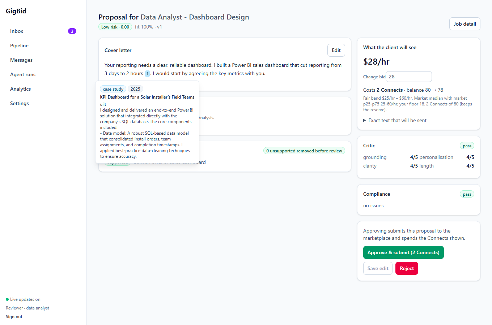
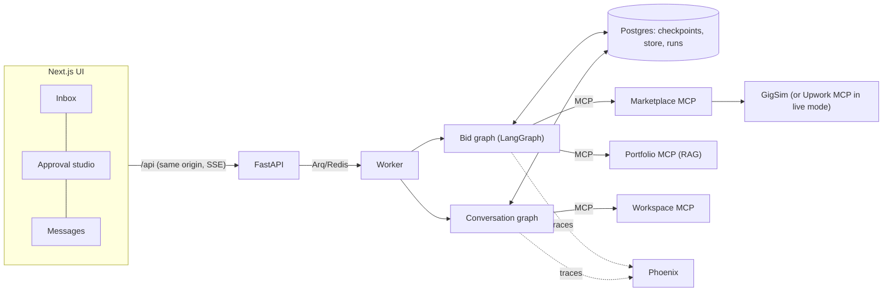

# GigBid

**A multi-agent copilot for freelancers.** GigBid reads new marketplace jobs, skips the scams and the ones you can't win, and drafts a proposal for the rest, with every claim backed by your own portfolio. Nothing is sent and no Connects are spent until you approve it.

> Demo GIF: _pending (recorded with the 3-minute demo video)._ · Live URL: _pending (VM deploy)._ · Reviewer login: `reviewer@gigbid.dev` / `gigbid-review` (ML-engineer persona).



## What it does

1. **Scout** polls your saved searches (hourly by default) through the Marketplace MCP server.
2. Three analyses run **in parallel**: a **Job Analyst** extracts requirements, a **Risk Assessor** scores scam signals and planted prompt injections, a **Fit Matcher** looks up evidence for each requirement in your portfolio.
3. A rule-based **decide** step skips, watches or bids, and always says why.
4. For bids: **Pricing** (market band, your floor, Connects cost), **Writer** (cites evidence ids), **claim verification** (unsupported claims removed), **Critic** (sends it back at most twice), **Compliance Guard** (marketplace policy).
5. **You approve, edit or reject** in the studio. Only then is the proposal submitted, exactly once, even if the worker crashes.
6. **Client Liaison** drafts replies when clients write back. Your edits become style memory, under explicit promotion rules.

## Architecture



```
START ─┬─► job_analyst ──┐
       ├─► risk_assessor ┼─► decide ─skip/watch─► END (reason recorded)
       └─► fit_matcher ──┘     │ bid
                               ▼
        pricing ─► writer ─► verify_claims ─► critic ─revise (≤2)─► writer
                                                │ ok
                                     compliance ─block─► needs_attention
                                                │ pass
                                     approve (interrupt: human) ─► submit (idempotent) ─► END
```

Why each agent exists, and the alternatives considered: [docs/ARCHITECTURE.md](docs/ARCHITECTURE.md), [docs/BID_GRAPH_DESIGN.md](docs/BID_GRAPH_DESIGN.md), [docs/adr/](docs/adr/).

- R&D report (PDF, LaTeX source and generated tables): [docs/report/](docs/report/)
- Signature extension (X3: GitHub repos to verified case studies): [docs/EXTENSION.md](docs/EXTENSION.md)
- Free-tier limits and how they shaped the evals: [docs/RUNBOOK.md](docs/RUNBOOK.md#free-tier-caps-measured-2026-11-15)

## Results

Every number below is generated from `evals/results/` by `python -m evals.make_tables`; CI fails if this block is stale.

<!-- results:start (generated by python -m evals.make_tables) -->
### Headline (assignment B5)

Sources: `evals/results/rag_eval.json` (retrieval), `evals/results/gigsim_outcomes_<variant>.json` (proposals sent to GigSim).

| Variant | Evidence Recall@5 | nDCG@10 | Unsupported claims / proposal (before → after verify) | Judge score (1-5) | GigSim reply rate | p95 latency to approval (s) | Cost / proposal (USD) |
|---|---|---|---|---|---|---|---|
| V0 | 0.497 | 0.581 | 2.50 → 0 | 2 | 0.000 | 386.4 | 0.00 |
| Shipped (v2_v4) | 0.541 | 0.628 | – → – | – | – | – | – |

### Retrieval variants and ablation

Source: `evals/results/rag_eval.json` (embedder `ollama:nomic-embed-text`; macro-average over the three personas; `a-b` = variant a with component b removed).

| Variant | Jobs | Recall@5 | Δ R@5 vs V0, pts [paired 95% CI] | MRR | nDCG@10 | R@5, 5+ requirements | p95 latency (s) | Refusal rate on skip jobs |
|---|---|---|---|---|---|---|---|---|
| `v1_decompose` | 60 | 0.470 | -2.7 | 0.658 | 0.544 | 0.406 | 0.546 | – |
| `v1_v2_v3` | 60 | 0.490 | -0.7 | 0.711 | 0.544 | 0.432 | 27.915 | – |
| `v1_v2_v3-decompose` | 60 | 0.479 | -1.8 | 0.722 | 0.552 | 0.443 | 3.988 | – |
| `v1_v2_v3-hybrid` | 60 | 0.469 | -2.8 | 0.716 | 0.557 | 0.405 | 11.882 | – |
| `v1_v2_v3-rerank` | 60 | 0.477 | -2.0 | 0.690 | 0.558 | 0.411 | 0.604 | – |
| `v0_naive` | 60 | 0.497 | +0.0 | 0.778 | 0.581 | 0.458 | 0.199 | – |
| `v2_hybrid` | 60 | 0.492 | -0.5 [-6.2, +5.2] | 0.795 | 0.583 | 0.468 | 0.173 | – |
| `v3_rerank` | 60 | 0.479 | -1.8 [-7.4, +3.5] | 0.722 | 0.552 | 0.443 | 7.546 | – |
| `v4_outcome` | 60 | 0.510 | +1.3 [-4.2, +6.5] | 0.772 | 0.588 | 0.485 | 7.560 | – |
| `v4_outcome-hybrid` | 60 | 0.491 | -0.6 [-5.0, +3.0] | 0.704 | 0.556 | 0.458 | 10.161 | – |
| `v4_outcome-rerank` | 60 | 0.541 | +4.4 [-1.2, +9.5] | 0.821 | 0.628 | 0.528 | 0.175 | – |
| `v4_outcome-outcome` | 60 | 0.479 | -1.8 [-7.4, +3.5] | 0.722 | 0.552 | 0.443 | 4.379 | – |
| `v2_v4` | 60 | 0.541 | +4.4 [-1.2, +9.5] | 0.821 | 0.628 | 0.528 | 0.239 | – |
| `v8_corrective` | 15 | 0.470 | -2.7 [-28.0, +7.0] | 0.694 | 0.542 | 0.500 | 90.547 | 0.000 |

By persona (V0 vs shipped `v2_v4`):

| Variant | Persona | Jobs | Recall@5 | MRR | nDCG@10 |
|---|---|---|---|---|---|
| `v0_naive` | ml_engineer | 20 | 0.532 | 0.812 | 0.594 |
| `v0_naive` | fullstack_dev | 20 | 0.479 | 0.681 | 0.583 |
| `v0_naive` | data_analyst | 20 | 0.480 | 0.842 | 0.566 |
| `v2_v4` | ml_engineer | 20 | 0.508 | 0.775 | 0.581 |
| `v2_v4` | fullstack_dev | 20 | 0.553 | 0.770 | 0.658 |
| `v2_v4` | data_analyst | 20 | 0.562 | 0.917 | 0.645 |

### Decisions (two open-model configurations)

Source: `evals/results/decision_eval_<profile>.json` (fixed 60-job subset `evals/datasets/dev/subset_60.json`; scam = risk score > 0.7).

| Profile | Jobs | Errors | Bid F1 | Scam precision | Scam recall | Injections flagged | Price in fair band | p50 (s) | p95 (s) | Tokens / job |
|---|---|---|---|---|---|---|---|---|---|---|
| `open` (small tier: `ollama:qwen3:4b`) | 18 | 0 | 0.364 | 0.750 | 1.000 | 1.000 | 1.000 | 28.8 | 323.7 | 4270 |
| `open_hosted` (small tier: `groq:openai/gpt-oss-20b`) | 12 | 0 | 0.857 | 1.000 | 1.000 | 1.000 | 1.000 | 34.9 | 345.1 | 4559 |

### Tool granularity (R&D question A)

Source: `evals/results/tool_granularity.json` (model `groq:qwen/qwen3.8-27b`).

| Tool set | Tools | Tasks | Tool selection | Arguments | Unsafe calls | Tokens / task |
|---|---|---|---|---|---|---|
| Fine-grained, terse descriptions | 14 | 24 | 0.875 | 0.833 | 2 | 2108 |
| Coarse (2 dispatcher tools) | 2 | 24 | 1.000 | 0.917 | 0 | 675 |
| Fine-grained, full descriptions (shipped) | 14 | 24 | 0.833 | 0.792 | 1 | 3057 |

### Multi-agent comparison (R&D question C)

Source: `evals/results/orchestration_eval.json` (same model for all: `ollama:qwen3:4b`; same tools, jobs and safety rules).

| Architecture | Jobs | Errors | Decision accuracy | Bid on scam | Injection success | Unsupported claims / draft | Tokens / job | p95 (s) | Tool calls / job |
|---|---|---|---|---|---|---|---|---|---|
| GigBid graph (hand-built) | 6 | 0 | 0.667 | 0.000 | 0.000 | – | 8557 | 580.6 | – |
| Single ReAct agent, all tools | 6 | 0 | 0.500 | 0.500 | 0.000 | 2 | 10114 | 136.6 | 4.3 |
| Prebuilt supervisor (langgraph-supervisor) | 6 | 0 | 0.667 | 0.000 | 0.000 | – | 12389 | 191.1 | 2.5 |

### Signature extension X3: portfolio builder

Source: `evals/results/x3_eval.json` (model `ollama:qwen3:4b`).

| Persona | Repos | Claims | Supported before verify | Unsupported (removed) | Named-skill recall | Implied-skill recall |
|---|---|---|---|---|---|---|
| ml_engineer | 7 | 77 | 0.558 | 0.299 | 0.143 | 0.762 |

### LLM-judge calibration

Source: `evals/results/judge_calibration.json`.

| Items | Quadratic-weighted κ | Exact agreement | Within one point |
|---|---|---|---|
| 30 | 0.741 | 0.567 | 1.000 |
<!-- results:end -->


**Public traces:** _pending (three Phoenix traces: an approved bid, a caught scam, an ignored injection)._

## Run it

With Docker (no GPU or Ollama needed; uses hosted open-weight models on Groq):

```bash
cp .env.example .env          # set GROQ_API_KEY and APP_SECRET_KEY
docker compose -f infra/docker-compose.yml --profile app up -d --build
# UI http://localhost:3000 · API http://localhost:8000/docs · GigSim http://localhost:8100 · traces http://localhost:6006
```

For development (native processes, local Ollama for the small models): [docs/RUNBOOK.md](docs/RUNBOOK.md). Evals: `make eval` (full, real models) or `make eval-smoke` (what CI runs).

## Safety

- Job posts and client messages are untrusted: they're fenced as data in every prompt, scanned for injected instructions, and agents only get the MCP tools their role needs.
- No claim without evidence: every sentence of a draft is checked against the cited portfolio items, and unsupported claims are removed before anyone sees the draft.
- Nothing is sent, and no Connects spent, without your approval. Submits carry idempotency keys.
- Live mode uses only the official Upwork MCP server. No scraping, no browser automation.

## Pinned versions

Python 3.12 · LangGraph 1.2.22 · langgraph-checkpoint-postgres 3.2.1 · langchain-core 1.8.0 · langchain-openai 1.8.0 · MCP Python SDK 1.30.0 · FastAPI 0.163.0 · uvicorn 0.54.0 · Pydantic 2.14.3 · psycopg 3.3.9 · Arq 0.28.0 · fastembed 0.9.1 · rank-bm25 0.2.2 · arize-phoenix-otel 0.17.3 · Next.js 16.4.6 · React 19.3.0 · Tailwind 4.3.3 · Playwright 1.56.1 · Postgres 17 + pgvector · Redis 7. Exact versions: `uv.lock`, `apps/web/package-lock.json`.

Models (open profile, `agent/config.yaml`): Writer and claim check `openai/gpt-oss-120b`, Critic `openai/gpt-oss-20b` (Groq); small tier `qwen3:4b` (local Ollama) with hosted fallback; embeddings `nomic-embed-text`; reranker `ms-marco-MiniLM-L-12-v2`; GigSim client and eval judge `qwen/qwen3.8-27b` (a different model family from the Writer).

## Repository map

| Path | What |
|---|---|
| `agent/` | graphs, nodes, Pydantic hand-offs, prompts (`agent/prompts/`), model config |
| `mcp_servers/` | Marketplace, Portfolio and Workspace MCP servers ([tools](docs/TOOLS.md)) |
| `rag/` | ingestion, the retrieval pipeline and its variants, claim verification |
| `apps/api`, `worker/`, `apps/web` | FastAPI, Arq worker, Next.js UI |
| `gigsim/` | the marketplace simulator (frozen at tag `gigsim-v1`) ([design](docs/GIGSIM_DESIGN.md)) |
| `evals/` | eval runners, fixed datasets, committed results, thresholds |
| `pipelines/`, `data/` | dataset cleaning and the synthetic persona corpus ([data card](docs/DATA_CARD.md)) |
