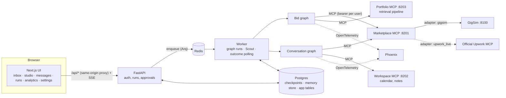

# Architecture

GigBid is two LangGraph graphs run by a background worker, talking to the outside world only through MCP servers, with a human approval gate before anything leaves the system. Decision records: [adr/](adr/). Node-level detail: [BID_GRAPH_DESIGN.md](BID_GRAPH_DESIGN.md). Tools: [TOOLS.md](TOOLS.md).

## Components



## The two graphs

**Bid graph** (one thread per job, `agent/graphs/bid_graph.py`):

```
START ─┬─► job_analyst ──┐
       ├─► risk_assessor ┼─► decide ─skip/watch─► END (reason recorded)
       └─► fit_matcher ──┘     │ bid
                               ▼
        pricing ─► writer ─► verify_claims ─► critic ─revise (≤2)─► writer
                                                │ ok
                                     compliance ─block─► needs_attention
                                                │ pass
                          approve (interrupt) ─edit─► compliance (re-check)
                                │ approve           ─reject─► END
                                ▼
                         submit (idempotent) ─► END
```

**Conversation graph** (one thread per client conversation, `agent/graphs/conversation_graph.py`):

```
START ─► read_thread ─► classify ─call requested─► offer_slots ─► draft_reply
                                 └─otherwise──────────────────────►┘
draft_reply ─► reply_compliance ─► approve_reply (interrupt) ─approve─► send_reply ─► END
                                                             ─edit─► reply_compliance
                                                             ─reject─► END
```

Both graphs checkpoint to Postgres after every node, so a run waiting for approval survives restarts, and a crash between approval and submit resumes without a second submit (idempotency keys on every marketplace write).

## Why each agent exists

| Agent (node) | Why it is separate | Model tier |
|---|---|---|
| Scout (worker task) | Polling is scheduled work, not reasoning; it de-duplicates jobs and caps new analyses per run | none |
| Job Analyst | Turns free text into a typed `JobSpec` (requirements, deliverables, screening questions) that every later node relies on | small |
| Risk Assessor | Scam and injection detection must run before any drafting, and must be explainable: rules compute the score, the LLM only extracts signals | small + rules |
| Fit Matcher | Evidence per requirement, judged strong / partial / missing; the same evidence later backs the proposal's claims | small |
| decide | Bid / watch / skip is a threshold rule over the three reports, so it's cheap, stable and always has a reason | none |
| Pricing | Market band, client budget, user floor and Connects cost are arithmetic; an LLM only writes the one-line rationale | none |
| Writer | The only node that writes prose for the client; cites evidence ids | strong |
| Claim verification | Removes unsupported claims before review (ADR 0006) | strong |
| Critic | A second opinion on grounding, personalisation and clarity; bounded to two revisions | critic |
| Compliance Guard | Marketplace policy (contact details, off-platform, guarantees) as config rules; can strip or block | rules |
| Approval | The human gate: approve, edit (re-checked by Compliance) or reject | none |
| Client Liaison | Classifies client messages, offers calendar slots, drafts replies; also gated by approval | small / strong |

The three analyses run in parallel (`Send`) because none depends on another; this cuts latency to approval.

## Marketplace port

Agents call one tool surface (`search_jobs`, `get_job`, `get_client_history`, `get_market_stats`, `get_connects_balance`, `list_proposals`, `create_proposal_draft`, `submit_proposal`, `list_threads`, `list_messages`, `send_message`). The Marketplace MCP server maps it to a backend adapter: `gigsim` (default) or `upwork_live` (the official Upwork MCP server). Switching is configuration (`MARKETPLACE_BACKEND`); agents, prompts and graphs don't change.

## Stores

| Store | What | Lifetime |
|---|---|---|
| Graph state (Postgres checkpoints) | One job's or conversation's working data: reports, evidence, drafts, approval | the thread |
| Execution trace (Phoenix) | Every node, model call and tool call, with tokens and latency | retained for debugging and evals |
| Long-term memory (Postgres store) | Style rules learned from the user's edits, outcomes of submitted proposals | until deleted from the UI |
| App tables (Postgres) | Users, encrypted MCP credentials, runs, saved searches | the account |
| MCP server state (SQLite per server) | Audit log, rate limits, idempotency records, embedding cache | per server |

These stay apart on purpose. Nothing reaches long-term memory except through `agent/memory/promotion_rules.py`. For example, a style pattern must appear in at least three edits, and more than twice as often as its opposite. Raw tool output never enters memory.
